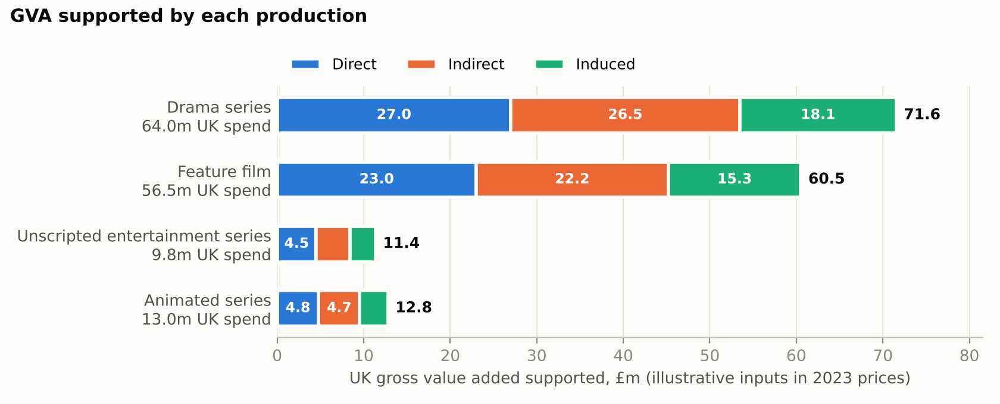
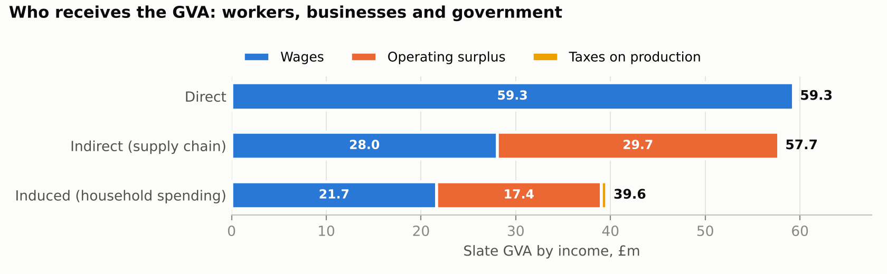
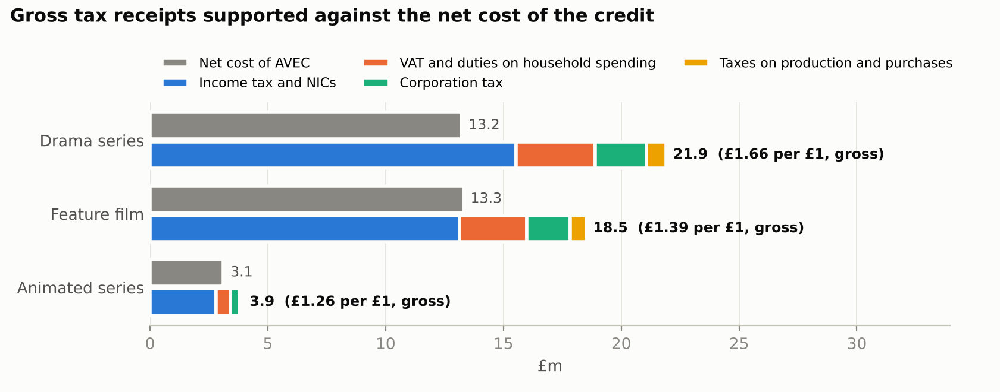
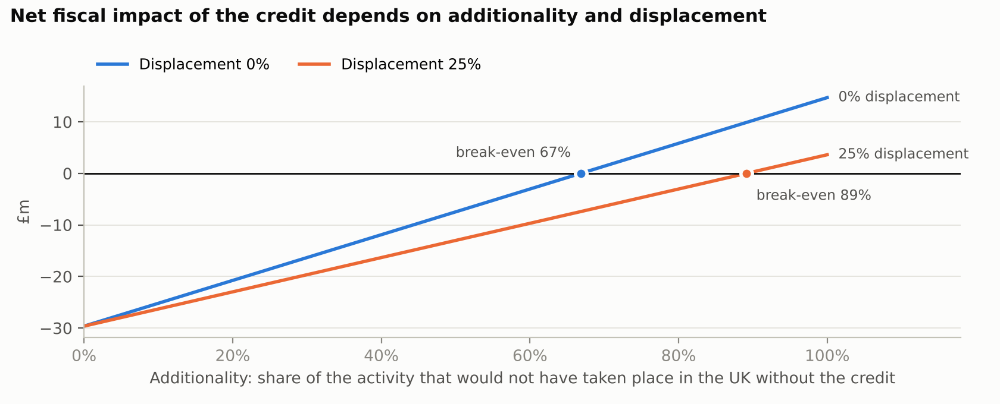
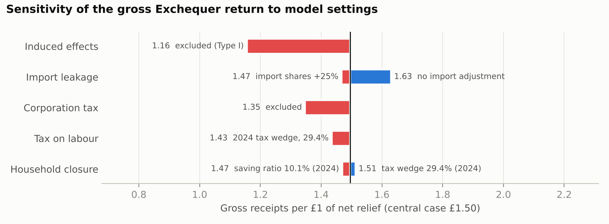
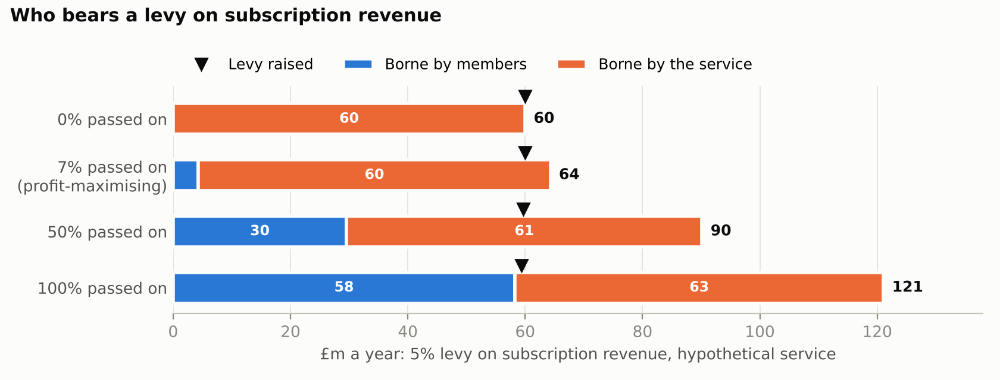

# Screen production economic impact model (UK)

A streaming service that commissions UK productions is asked the same questions by government, regulators and the press: what does its production spending contribute to the UK economy, where in the country does it land, what does the Exchequer get back for the tax credit it pays, and what would a levy on subscriptions cost and who would bear it. This repository answers those questions from the data such a service already holds, using a UK input-output model built on the ONS Input-Output Analytical Tables for 2023. The core engine reproduces the ONS published effects for all 104 industries, so every headline figure can be traced to official statistics. The sections below set out what goes in, what comes out, how the calculations work and how far the results can be relied on.

All production, payroll and membership figures in `examples/` are invented to demonstrate the method. They do not describe any real production, studio, service or company.

## Try it

The interactive explorer (`app.py`) runs the model in a browser. A reviewer can switch between the slate and a single production, edit a cost report, bring spending into the UK, change the model settings, move from gross tax receipts to the net fiscal effect of the credit, test a levy on subscriptions and rerun the validation and test suite. The hosted version is linked from this repository's About panel. To run it locally:

```bash
pip install -r requirements.txt
streamlit run app.py
```

A one-page technical and policy note for non-specialist readers is in [`docs/technical_note.pdf`](docs/technical_note.pdf).

## Quick start

```bash
pip install -r requirements.txt
python make_outputs.py            # builds the output pack in outputs/ from the illustrative inputs
python io_footprint.py validate   # reproduces the ONS published results
python -m pytest -q               # 34 tests, including a headless run of the app
```

### Running from R

`run_in_r.R` runs the model from R through the reticulate package, which calls the Python code inside the R session and returns results as R data frames. It needs R, `install.packages("reticulate")` and Python 3.9 or later on the machine (if R reports that no Python is found, run `reticulate::install_python()` first). On its first run the script creates a Python environment called `screen-impact` with numpy, pandas and matplotlib, which takes a minute or two; later runs reuse it. Start from a fresh R session (in RStudio, Session > Restart R), because reticulate connects to one Python per session. From this folder, run `Rscript run_in_r.R`, or open the script in RStudio and source it.

## What goes in

The inputs are records a commissioning business keeps for its own purposes. The model needs no new data collection.

| Internal record | Used for |
|---|---|
| Production cost report top sheets (spend by cost category) | Direct effect and supply-chain demand, through a single mapping from cost category to ONS industry (`mappings/cost_categories.csv`) |
| Where each cost was incurred (UK nation or region, or outside the UK) | Spend leaving the UK; spending by nation and region; the 80% cap in the credit calculation |
| Payroll for cast and crew | Direct GVA and wages from pay; direct jobs as reported (`examples/illustrative_payroll.csv`), which replace the modelled figure |
| Format and certification status | Credit eligibility and rate |
| Members, revenue per member and the response to past price changes | Value to members and the incidence of a levy (`welfare.py`) |

A slate of any size runs in one pass, and every production is treated by the same rules. Adding a production means adding its cost-report lines to the input file. Inputs are checked before the model runs: every problem in a file (an unknown cost category or location, a negative or missing amount, a production with two formats, payroll jobs reported outside the UK) is listed in one message so the file can be fixed in one pass.

## What comes out

`python make_outputs.py` writes a plain-English summary (`outputs/impact_summary.md`), nine tables and six charts. The figures below come from the illustrative slate of four productions: a drama series, a feature film, an unscripted entertainment series and an animated series. Money figures are in the prices of the inputs, which are stated in 2023 prices.

**Economic contribution.** The four productions had budgets of £152.8m, of which £143.3m was spent in the UK. Including UK supply chains and the spending of the wages paid, that spend supported £156.3m of UK GVA and 2,199 full-time equivalent jobs. Of those jobs, 943 were on the productions themselves as reported in payroll; the model would have estimated 1,148 from pay at the film and TV industry average, because screen work pays above that average. The drama series and the feature film account for most of the total because they are the largest, but the split by effect is similar across all four: between 37% and 40% of the GVA is on the production, a similar share is in its suppliers and about a quarter is in the wider economy as wages are spent.



**Who receives it.** GVA is income, so it can be split by who receives it. Of the £156.3m, £109.0m is wages and £47.1m is operating surplus earned by UK businesses in the supply chain and in the shops, restaurants and services where workers spend their pay. The operating surplus is the producer surplus of those businesses before the cost of their capital. On the productions themselves all of the GVA is wages, because the model counts only what the production pays its cast and crew and adds no profit margin; this makes the direct figure a lower bound.



**The tax credit and gross receipts.** The drama series, feature film and animated series would qualify for the Audio-Visual Expenditure Credit; unscripted entertainment is outside the scheme. The three eligible productions would claim £39.5m of credit, a net cost to the Exchequer of £29.6m because the credit is itself taxed at 25%. The activity they support generates £44.3m of tax receipts, over two thirds of it income tax and National Insurance on wages, or £1.50 of gross receipts for every £1 of net relief. The drama series returns the most per £1 because almost all of its budget is spent in the UK and the 80% cap limits the credit it can claim. The feature film returns less because more of its budget is spent abroad, which leaves more room under the cap, and its UK visual effects attract the higher 39% rate. The animated series receives the 39% animation rate on a budget that relies more on purchased services, some of them from outside the UK.



**From gross receipts to the effect on the public finances.** Gross receipts count tax on all the activity the productions support, including any that would have taken place in the UK without the credit, so they measure contribution. The effect of the credit itself depends on additionality, the share of the activity that would not have taken place in the UK without it, and displacement, the share of that additional activity that draws on workers and resources that would otherwise have been employed elsewhere in the UK. The credit is paid on every eligible production, so its cost does not fall with additionality. With no displacement, the receipts caused by the credit cover its cost once additionality reaches 67%; with 25% displacement the threshold rises to 89%. At 50% additionality and no displacement the credit would cost the Exchequer £7.5m net (`outputs/net_fiscal.csv`). These thresholds are the figures to set against evidence on how location decisions respond to the credit.



**How firm the gross result is.** The gross return is most sensitive to whether induced effects are counted. Excluding them lowers it to £1.16 per £1; removing the import adjustment raises it to £1.63. Corporation tax, the tax rate on labour and the household closure each move it by 15p or less.



**Where the money was spent.** 56% of UK spend in the slate took place outside London, mostly in the South East around the studio, with smaller shares in Scotland, Wales, the North West and Northern Ireland (`outputs/region.csv`). The table reports UK spend, own cast and crew pay and reported jobs by where they occurred. The ONS publishes UK tables only, so the model does not estimate supply-chain or household-spending effects for individual nations and regions.

**Value to members and a levy on subscriptions.** For a hypothetical service with 10 million members paying £10 a month and a membership price elasticity of 1.2, members receive about £500m a year of value above what they pay. A 5% levy on subscription revenue would raise about £60m a year. The cost of serving one more member is set so that the current price is the one that maximises profit, which with this elasticity puts it at 17% of the price. On that basis the service would pass on about 9% of the levy: its price rises by about 4p a month, around 53,000 members leave, members lose £5m of value and the service bears £60m. A levy on revenue takes the same share of revenue at every price, so it gives a service with low running costs little reason to raise its price. If the service passed the levy on in full, about 600,000 members would leave, members would lose £58m and the combined loss to members and the service would exceed the levy raised by £62m. The elasticity and the cost of serving each member decide the split, and both come from the service's own pricing data.



## How it works

**Supply chain (Type I).** The ONS domestic use table records what each of 104 industries buys from every other UK industry. Dividing each column by the industry's output gives the technical coefficients, A, and the Leontief inverse, L1 = (I − A)⁻¹, gives the total UK output needed across all rounds of the supply chain to deliver £1 of an industry's product. Industry ratios of wages, operating surplus, taxes on production and jobs to output convert output into the measures people report.

**From what was spent to what UK industries receive.** Cost reports record what the production paid, at purchasers' prices and net of recoverable VAT, in the prices of the year the money was spent. The price bridge removes distributors' margins (passing them to wholesale), removes the non-deductible product taxes the film and TV industry pays on its purchases at its own ONS rate (0.14% in 2023, counted as a tax receipt), and removes the imported share of each product using ONS import shares. What remains is first-round demand on UK industries at basic prices, the price basis of the ONS tables. The spend bridge reconciles every step back to the budget, so the figures can be tied to the cost reports and to the company's own accounts. Results are in the same prices as the inputs; the jobs coefficients are 2023 values, so inputs from another year need a price index (`Settings.price_index`).

**Household spending (Type II).** ONS publishes Type I results only. Induced effects close the model with respect to households: they earn wages from every industry and spend them in line with the ONS pattern of household consumption of UK output. The share of each £1 of wages that is spent comes from the OECD tax wedge (31.2%) and the ONS household saving ratio (6.2%) for 2023, giving 64.5p of consumer spending per £1 of wages. The validation checks the matrix result against a closed-form calculation.

**The credit.** The Audio-Visual Expenditure Credit is calculated on UK core expenditure, capped at 80% of total core expenditure, at 34% for film and high-end TV and 39% for animation and children's TV. UK visual effects costs receive 39% and are exempt from the cap, following HMRC's method in CREC061410. The credit is taxable, so its net cost is 75% of the gross credit. The calculation uses a single accounting period and assumes every eligible production is certified as British.

**Tax receipts.** Receipts use average effective rates applied to the income the activity supports: the tax wedge on wages for income tax and National Insurance; ONS product taxes per £ of household spending (10.4%) for VAT and duties on wages spent; ONS taxes on production by industry; and corporation tax at HMRC's 2023 to 2024 receipts as a share of UK operating surplus (10.1%). The ONS records net subsidies of £2.1bn for the film and TV industry in 2023, consistent with the screen credits, so industries where subsidies exceed taxes count as zero in the receipts to avoid counting the credit twice.

**Members and levies.** Demand for membership is linear through the current price and membership at the stated elasticity. This is the conservative choice: a constant-elasticity curve gives a much larger value to members for the same elasticity. Unless it is entered directly, the cost of serving one more member comes from the pricing condition of a service that maximises profit, (P − MC)/P = 1/elasticity, so the price, elasticity and cost assumptions agree with each other. A levy is charged on subscription revenue. The model reports the share a profit-maximising service would pass on, c/(2(1 − levy)P) with linear demand, and for any chosen pass-through the levy raised, the cost to members, the cost to the service and the excess of the two over the levy.

**Two modes.** Mode 1 treats spending as demand for an industry's output with that industry's average supply chain; with a single industry it reproduces the ONS published effects exactly. Because the supply chain is already implied, mode 1 rejects reported purchases, which would count it twice. Mode 2, used for productions, drives the supply chain from what was actually bought.

```
A = Z diag(x)⁻¹          L1 = (I − A)⁻¹          A* = [[A, c], [w', 0]]          L2 = (I − A*)⁻¹
Direct: own pay (and any in-house output)        Indirect output = L1·p
Induced output = L2[n,n]·p + L2[n,h]·W − L1·p    c = κ·s,  κ = (1 − tax wedge)(1 − saving ratio)
Bridge: b(i) = E(i)·(1 − m − t)·(1 − μ(i)) + margins re-routed to wholesale;  t = film and TV product-tax rate
Credit: 34%·min(UK core, 80%·total core) + 39%·VFX − 34%·max(0, VFX − cap reduction)
Net fiscal impact = gross receipts · additionality · (1 − displacement) − net cost of the credit
```

## Validation

`python io_footprint.py validate` runs the checks below; all pass, and the explorer's Model validation tab shows them live alongside a comparison with ONS for any industry. The 34 automated tests repeat the ONS reproduction for five industries and check the credit against HMRC's worked method, the price bridge and spend bridge, the input checks, reported jobs, the net fiscal calculation, the levy incidence and its profit-maximising pass-through, and a headless run of the app. GitHub Actions runs the validation and the tests on every change (`.github/workflows/tests.yml`).

| Check | Result |
|---|---|
| Output, GVA and compensation equal the Blue Book 2025 totals | exact |
| GVA equals wages plus operating surplus plus taxes on production, every industry | exact |
| Model Leontief inverse against the ONS published inverse, largest difference | 5.8 × 10⁻¹⁵ |
| Type I output multipliers, GVA effects and wage effects against ONS | ≤ 6.2 × 10⁻¹⁵ |
| Type I FTE effects against ONS (rounding in the ONS employment table) | 6.3 × 10⁻⁸ |
| Leontief and Type II identities; induced effects by two routes | ≤ 2.0 × 10⁻¹⁴ |
| £1 of final demand for film and TV production reproduces the ONS Type I GVA effect | 5.6 × 10⁻¹⁶ |
| Price bridge conserves spend | < 1 × 10⁻¹³ |

## Taking it to other markets

Everything specific to the UK sits in three places: the ONS tables in `data/`, the tax and credit parameters in `config/uk.json`, and the household closure. A second market needs its national input-output tables in the same layout, its own config file with the local incentive rules and tax rates, and its own validation against the national statistics office's published multipliers. The cost-category mapping and the slate pipeline carry over unchanged, so productions in every market are measured the same way.

## Assumptions and limitations

- Economic and tax results are gross contribution estimates. They describe the activity associated with the spending at the current structure of the economy and make no causal claim about the credit. The net fiscal calculation and the break-even additionality are the bridge to a net assessment in the sense of the HM Treasury Green Book; the additionality and displacement shares need evidence from outside the model.
- Input-output models assume fixed input proportions, constant returns to scale and no capacity or price effects. Large expansions in a tight labour market will overstate the supply-chain response.
- Direct GVA is cast and crew pay with no profit margin unless `direct_margin_on_pay` is set. The cost-category mapping and the core and VFX flags are indicative and should be agreed with the production accountants.
- Tax receipts use average effective rates. Many crew are freelance and pay a different mix of income tax and National Insurance from the average employee in the OECD wedge.
- Margin rates are averages for ten product groups and the product-tax rate is the film and TV industry average; import shares are averages across users. ONS combines film and TV production with broadcasting (J59 & J60).
- The ONS tables cover the UK as a whole. Results by nation and region are limited to spending, pay and reported jobs.
- Reported direct jobs are attached to the industries where pay is recorded. Spillovers such as screen tourism, skills and exports are outside the model.
- The levy calculation assumes linear demand, a constant cost of serving one more member and a single service; it does not model changes to the content budget or responses by competing services.
- Coefficients describe 2023. For spend from later years, set `Settings.price_index` so the jobs figures are on 2023 prices.

## Sources

1. Office for National Statistics (2025), UK input-output analytical tables: industry by industry, 2023.
2. Office for National Statistics (2025), UK input-output analytical tables: product by product, 2023.
3. Office for National Statistics, Employment multipliers and effects in the UK, 2023.
4. Office for National Statistics (2025), UK National Accounts, The Blue Book: 2025, Table 2.1d and National accounts at a glance.
5. OECD (2025), Taxing Wages 2025, country note: United Kingdom.
6. HMRC (2024), Annual Report and Accounts 2023 to 2024, Trust Statement note 2.3, Corporation Tax.
7. BFI, About UK creative industry expenditure credits.
8. HM Treasury and HMRC (2024), Corporation Tax: additional tax credit for visual effects expenditure, policy paper.
9. HMRC, Creative Industries Expenditure Credit Manual, CREC061410.
10. Miller, R.E. and Blair, P.D. (2022), Input-Output Analysis: Foundations and Extensions, third edition, Cambridge University Press.
11. Emonts-Holley, T., Ross, A. and Swales, J.K. (2021), Estimating induced effects in IO impact analysis, Economic Systems Research, 33(4).

## Licence

Code: MIT licence (see `LICENSE`). Data in `data/`: contains public sector information licensed under the Open Government Licence v3.0 (Crown copyright, Office for National Statistics).
